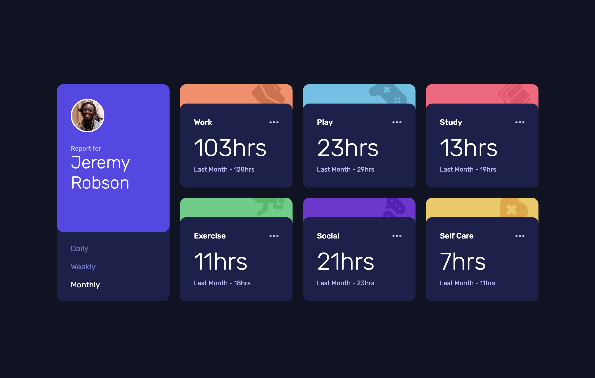

# Time Tracking Dashboard

A responsive time tracking dashboard built as part of a Frontend Mentor challenge.

- Live: [GitHub Pages](https://kirilenko-a.github.io/time-tracking-dashboard/)
- Code: [GitHub](https://github.com/kirilenko-a/time-tracking-dashboard)

## Built with

- Semantic HTML 5
- Javascript(ES6+)
- Fetch API
- Tailwind CSS v4
- CSS Grid
- Flexbox
- Responsive design
- Vite

## Features

- Responsive layout for mobile, tablet, and desktop
- Daily, weekly, and monthly activity tracking
- Dynamic data loading from JSON

## Author

- [GitHub](https://github.com/kirilenko-a)
- [Frontend Mentor](https://www.frontendmentor.io/profile/kirilenko-a)
